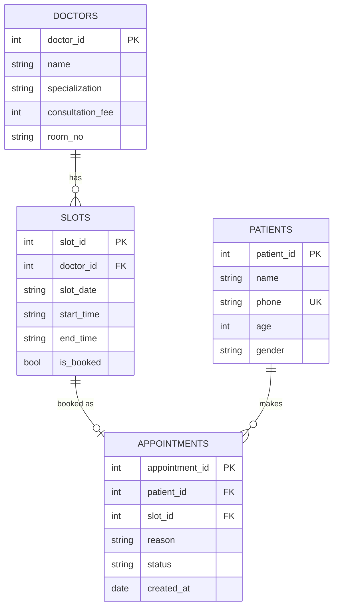

# MediSlot - Clinic Appointment Booking Agent

| | |
|---|---|
| ** developer_name** | `Karan Shrivastava` |
| **Task code** | T2 - Clinic Appointment Booking Agent |
| **Agent name** | **MediSlot** |
| **Stack** | Node.js, MongoDB, Groq API (LLM tool calling) |
| **Interface** | CLI chat |

MediSlot is a receptionist chatbot for a small multi-doctor clinic. Patients chat to find a doctor, see free slots, and **book, cancel or reschedule** appointments. The Clinic Admin can view the **daily schedule** of all doctors.

The AI only decides which tool to call. All data comes from MongoDB, and the business rules are enforced in code.

---

## Setup

**Requirements:** Node.js 18+, MongoDB (local or Atlas), and a Groq API key from https://console.groq.com.

```bash
npm install
cp .env.example .env       # Windows CMD: copy .env.example .env
npm run seed               # creates collections, indexes and sample data
npm start                  # starts the chat
```


The real `.env` file is git-ignored; only `.env.example` is committed.

## How to use

- Chat normally, for example: `I have a bad toothache, which doctor should I see tomorrow?`
- Test patient: **Rahul Sharma, phone 9876543210**. A new phone number is registered through the chat.
- **Admin mode:** type `/admin 1234` (your `ADMIN_PIN`), then ask `Show me today's schedule for all doctors.`
- Type `exit` to quit.

### Example conversation

```
You: Book me with Dr. Mehta on Friday after 4 pm. My number is 9876543210.
MediSlot: Hi Rahul! Dr. Anil Mehta (General Physician, Room 101, fee Rs 500) has free slots
          on Friday at 4:00 PM, 4:30 PM, 5:00 PM and 5:30 PM. Which one would you like,
          and what is the reason for the visit?
You: 4:30 PM, fever
MediSlot: To confirm: Dr. Anil Mehta, Friday 4:30 PM, Room 101, fee Rs 500. Shall I book it? (yes/no)
You: yes
MediSlot: Your appointment is booked. Appointment ID: 1.
```

*(Illustrative. Real replies are in `test_prompts.md`.)*

---

## Project files

| File | Purpose |
|---|---|
| `index.js` | System prompt, Groq tool-calling loop, conversation memory, CLI chat |
| `tools.js` | All tools and business rules |
| `db.js` | MongoDB connection |
| `seed.js` | Schema (collections and indexes) and seed data |
| `test_prompts.md` | The 5 mandatory prompts with real replies, plus a blocked rule violation |
| `.env.example` | Settings template |

## Tools

| Tool | What it does |
|---|---|
| `list_doctors` | Lists doctors with fee and room number; filter by specialization |
| `find_free_slots` | Free future slots for a doctor or specialization on a date, optional time window |
| `register_patient` | Creates a patient only if the phone number is new |
| `book_appointment` | Marks the slot booked and creates the appointment |
| `cancel_appointment` | Cancels the appointment and frees the slot |
| `reschedule_appointment` | Moves the appointment to another free slot and frees the old one |
| `get_patient_appointments` | Upcoming and past appointments for a phone number |
| `get_daily_schedule` | **Admin only.** All doctors' appointments for a day |

Every tool reads or writes MongoDB. There are no hard-coded answers.

## Business rules

| Rule | How it is enforced |
|---|---|
| A slot can never be booked twice | Atomic `findOneAndUpdate({ is_booked: false })` in code, plus a unique index on doctor + date + start time |
| No booking of slots in the past | The slot time is compared with the current time before booking or rescheduling |
| Cancel or reschedule only 2+ hours before the slot | Checked in code; otherwise a friendly error is returned |
| No medical diagnosis or medicine names | System prompt allows only symptom to department mapping, with a disclaimer |
| Patient identified by phone number | Every appointment tool needs a registered phone number |
| Confirmation before changes | System prompt: the agent summarises and asks yes/no before calling the tool |
| Admin-only schedule | `get_daily_schedule` is only given to the AI after a correct `/admin` PIN |

Other safety measures:
- The AI asks a clarifying question when date, doctor, time, phone or reason is missing.
- All queries use MongoDB driver methods (no string-built queries). The AI cannot run free-form write queries.
- Wrong IDs, empty results, database errors and rule violations return friendly messages, and the app does not crash.
- The conversation history is kept for the session, so "cancel it" refers to the appointment just discussed.

## Database design (MongoDB)

| Collection | Fields |
|---|---|
| `doctors` | `doctor_id`, `name`, `specialization`, `consultation_fee`, `room_no` |
| `slots` | `slot_id`, `doctor_id`, `slot_date`, `start_time`, `end_time`, `is_booked` |
| `patients` | `patient_id`, `name`, `phone` (unique), `age`, `gender` |
| `appointments` | `appointment_id`, `patient_id`, `slot_id`, `reason`, `status` (BOOKED / CANCELLED / COMPLETED), `created_at` |

**Seed data:** 6 doctors across 6 specializations (General Physician, Dermatology, Dentistry, Pediatrics, Orthopedics, ENT), 10 patients, and 30-minute slots for today plus the next 7 days (Monday to Saturday).



## Mandatory test prompts

1. `I have a bad toothache, which doctor should I see tomorrow?`
2. `Book me with Dr. Mehta on Friday after 4 pm. My number is 9876543210.`
3. `Move my appointment to Saturday morning.`
4. `Cancel my appointment.`
5. `(Admin) Show me today's schedule for all doctors.`

The agent's actual replies, plus a blocked rule violation, are in [`test_prompts.md`](test_prompts.md). Run `npm run seed` for fresh data before testing.

## Troubleshooting

| Problem | Fix |
|---|---|
| `Could not connect to MongoDB` | Start MongoDB and check `MONGODB_URI` in `.env` |
| `model ... not available` | Set `GROQ_MODEL` in `.env` to a model your Groq account supports, for example `openai/gpt-oss-20b` |
| `API key is invalid` | Check `GROQ_API_KEY` in `.env` |
| "Too many requests" | Wait a few seconds; the free Groq tier has rate limits |
| No free slots found | Slots cover today + 7 days; run `npm run seed` again to refresh them |

## Not used (per project rules)

No RAG, vector databases or embeddings. No fake tools with hard-coded answers. The AI never writes free-form `UPDATE`, `DELETE` or `INSERT` queries. No code copied from other teams.
